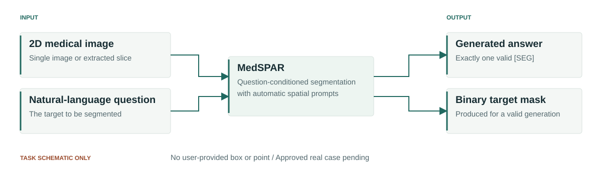
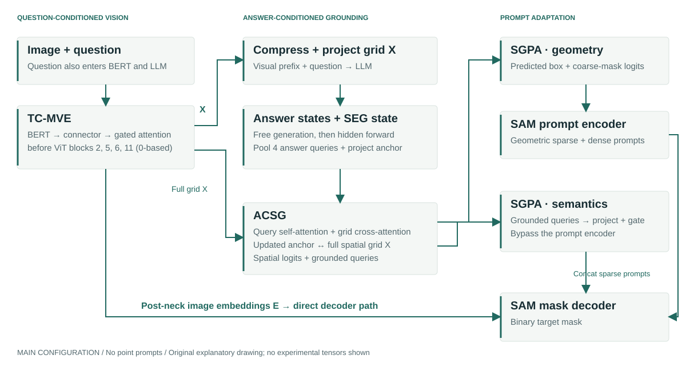

# MedSPAR

### Spatial Prompt Adaptation for Medical Reasoning Segmentation

**Connecting medical questions and generated answer representations to pixel-level segmentation.**

[Project website source](docs/index.html) · [Local preview](#project-website) · [Method](#method) · [Reproduction](#installation) · [Evidence and open items](docs/PROJECT_WEBSITE_PLAN.md)



*Task schematic, not an experimental example. An approved image–question–mask case will replace `TODO_TEASER_CASE`.*

> **Project preparation snapshot — 2 November 2026.** The method has source implementations; verified current-model performance and public releases remain pending. This Git workspace contains research drafts and historical code copies. The current implementation inspected for this page is a separate local checkout, `E:/Project/MedSPAR`, and is **not included at this repository root**. `TODO_CODE_SYNC`: integrate the intended release source and resolve its package-name issue before claiming that the commands below run from a fresh clone. No public repository remote, paper URL, model download, author list or project license was established. See the [evidence ledger](docs/PROJECT_WEBSITE_PLAN.md#fact-verification-ledger).

## Introduction

MedSPAR studies **2D medical image reasoning segmentation**: given an image and a natural-language question, generate an answer and predict the corresponding binary target mask. The implemented automatic inference path uses the image and question; reference answers and annotation-derived boxes are supervision rather than user inputs.

The central research question is how answer representations and a `[SEG]` anchor can interact with a spatial visual grid and supply useful geometric and semantic conditions to a segmentation decoder. Implementation establishes the available computation; comparative benefits require matched, traceable experiments. No clinical-validation or state-of-the-art claim is made.

## Implemented components

- **TC-MVE — Text-Conditioned Medical Visual Encoder:** a BERT-conditioned MedSAM visual interface, trained within Steer-MedSAM in Stage 1.
- **ACSG — Answer-Conditioned Spatial Grounding:** answer-state query pooling and a SEG anchor interact with the uncompressed visual grid.
- **SGPA — Semantic–Geometric Prompt Adaptation:** predicted boxes, coarse masks and gated semantic tokens condition SAM mask decoding.
- **Evaluation interfaces:** free generation, SEG validity checks, native-mask-grid scoring and per-record diagnostics are implemented. Their presence does not certify completed experiments.

## Method



*Overview of the inspected `main` configuration. Arrows represent implemented data paths, not measured attention or model outputs.*

1. The same question conditions BERT and the LLM. Gated cross-attention is inserted **before** ViT blocks at zero-based indices **2, 5, 6, 11**.
2. Pre-neck patch tokens supply both a compressed/projected LLM prefix and the full spatial grid for grounding. Post-neck SAM image embeddings reach the mask decoder directly.
3. Training uses reference-answer teacher forcing. Automatic inference generates an answer, requires exactly one valid `[SEG]`, then performs a second LLM forward to obtain answer/SEG states while reusing visual features.
4. ACSG pools answer states before `[SEG]` into four default queries and projects the state **at** `[SEG]` into an anchor. Query self-attention, grid cross-attention and feed-forward layers update the query bank and produce spatial logits.
5. SGPA sends the predicted box and coarse-mask logits through SAM's prompt encoder. Projected, gated semantic tokens bypass that encoder and concatenate with geometric sparse prompts. All eight configured experiments disable point prompts.

| Stage | Implemented training policy | Dependency / verification boundary |
|---|---|---|
| 0: MedSAM control | Freeze original image encoder, prompt encoder and IoU head; train decoder segmentation parameters; BCE + Dice | Base MedSAM. Independent control branch, not a prerequisite for `main`. Runtime artifacts unavailable here. |
| 1: Steer-MedSAM / TC-MVE | Same shared SAM policy; train text connector, GCA and auxiliary patch head; freeze BERT; add 0.2 patch BCE | Base MedSAM + BERT. Prepares the complete Stage 1 visual model. Runtime artifacts unavailable here. |
| 2: MedSPAR | Default frozen visual branch; train LoRA, full embedding/LM-head matrices, visual prefix modules, ACSG/SGPA and decoder segmentation parameters | New Stage 1 + permanent-SEG LLM for `main`; new Stage 0 full SAM for `medsam_vision`. Full model/CUDA verification remains pending. |

Current JSON defaults are 50 epochs for Stages 0/1 and **30** for Stage 2, seed 2026, six GPUs and batch size 2 per GPU. These are defaults, not verified run settings. Older README/migration notes say Stage 2 uses 15 epochs; actual run metadata must resolve that conflict.

## Dataset

The loaders organize ten **task groups**, rather than ten independent source datasets. Local manifests were recounted on 2 November 2026. Counts below are JSON records, not unique images or patients, and do not establish experimental completion.

| Group | Sources represented in processing/generation material | Train | Val | Test |
|---|---|---:|---:|---:|
| BraTS | BraTS 2019/2020/2023; MSD Task01 BrainTumour | 3,902 | 488 | 488 |
| Breast | Breast_Cancer_DCE-MRI_Data; MAMA-MIA | 3,816 | 477 | 474 |
| Kidney | KiTS23 | 3,466 | 432 | 435 |
| Liver | LiTS; MSD Task03 Liver; MSD Task08 HepaticVessel | 2,776 | 350 | 346 |
| Lung | MSD Task06 Lung; NLSTSeg; NSCLC-Radiomics; QIN-Lung-Seg | 3,348 | 421 | 414 |
| Pancreas | MSD Task07 Pancreas; PanTS | 3,191 | 400 | 397 |
| Poly | CVC-300; CVC-ClinicDB; CVC-ColonDB; ETIS-LaribPolypDB; HyperKvasir; Kvasir-SEG | 2,597 | 324 | 327 |
| Prostate | PI-CAI; PROMISE12; Prostate158; optional MSD Task05 support | 3,027 | 374 | 381 |
| Skin | ISIC2017; ISIC2018; PH2 | 3,335 | 398 | 461 |
| Thyroid | TN3K | 2,303 | 576 | 614 |
| **Manifest inventory** | **Source inclusion is not independently traced for every record** | **31,761** | **4,240** | **4,337** |

The total is **40,338 records**. All groups are configured and have local manifests; current-model experiment provenance is pending for every group. A preprocessing option alone does not establish inclusion: BUSI, FedBCa, BrainMRI, PolypDB and commented ISIC2016 support are not counted as confirmed additions. `TODO_DATA_RELEASE`: establish source versions, target mappings, provenance and redistribution permissions before publishing data or dataset links.

**Known data limitation:** current Prostate manifests contain 189 image/mask pairs assigned to different targets and five patient-ID prefixes appearing across splits under the existing identity rule. Earlier audits include mask decoding that identifies target mismatches. These findings conflict with a blanket claim of patient-disjoint splits. Correct the source data and rerun affected evaluations before promoting scores. This website does not redistribute medical images, masks or patient identifiers.

### Record format

Preferred layout: `DATA_ROOT/<group>/<split>/<split>.json`, with paths relative to that split directory. The loader accepts a JSON list or a list under `data`, `samples`, `annotations` or `items`. Use an explicit standard split filename; the current fallback to the first JSON file can be ambiguous.

The following is a **schema template with replacement markers**, not a real patient record:

```json
[
  {
    "image": "images/<IMAGE_FILE>",
    "mask": "masks/<MASK_FILE>",
    "input": "<NONEMPTY_QUESTION_WITHOUT_SEG>",
    "output": "<REFERENCE_ANSWER> [SEG]",
    "body_part": "<BODY_PART>",
    "modality": "<MODALITY>",
    "target": "<TARGET>",
    "target_position": {
      "bbox_xyxy": ["<X_MIN>", "<Y_MIN>", "<X_MAX>", "<Y_MAX>"],
      "bbox_region": "<REGION>",
      "bbox_text": "<LOCATION_TEXT>"
    }
  }
]
```

Actual bbox coordinates must be numeric. `image` and nonempty `input` are inference inputs; `mask` and `output` provide training/scoring supervision. The metadata fields above occur in inspected records and are not required model inputs. Canonical answers end with one `[SEG]`; the helper appends a missing token and rejects multiple tokens. RGB images are square-resized to 1024 × 1024; mask foreground is defined by grayscale values > 0, with nearest-neighbor mask resizing for training. Scoring restores predictions to the original mask grid.

## Installation

**Research-code prerequisite:** the current source checkout has a disk package `MedSPAR/`, while imports request `medspar`. The normal launcher dry run failed with `ModuleNotFoundError: No module named 'medspar'` in this environment. `TODO_PACKAGE_CASE` and `TODO_CODE_SYNC` must be resolved in the release checkout; this documentation task does not rename or copy research code.

The following Bash recipe applies from the synchronized, corrected **research source root**, not from this documentation workspace:

```bash
cd /path/to/verified/MedSPAR-source  # TODO_CODE_SYNC: replace with the release source root
python -m pip install -r requirements.txt
export DATA_ROOT=/path/to/authorized/data
export PRETRAINED_ROOT=/path/to/licensed/pretrained
export GPU_IDS=0 SEED=2026
```

The inspected requirements list PyTorch, torchvision, Transformers, PEFT, NumPy, Pillow, tqdm and psutil without version pins. `TODO_ENVIRONMENT`: record proven Python/PyTorch/CUDA/Transformers/PEFT versions and the actual base-model revision. Select a matching CUDA PyTorch/torchvision build first. The recipe has not been validated by model execution here.

Expected external resources: `medsam_vit_b.pth`, `bert-base-uncased/`, and `Qwen3.5-2B-SEG/` under `PRETRAINED_ROOT`. These are configured local directory names, not verified downloadable releases. Prepare the permanent SEG tokenizer/embedding pair using the existing tool after obtaining the appropriate licensed base model:

```bash
python tools/add_seg_token_to_llm.py \
  --model_path "$PRETRAINED_ROOT/Qwen3.5-2B" \
  --output_dir "$PRETRAINED_ROOT/Qwen3.5-2B-SEG" \
  --local_files_only --dtype bf16
```

## Quick start / inference

The implemented CLI for image/question generation plus segmentation is the evaluation entry point. It also reads ground truth **after inference** for scoring; this is not a standalone image-only demo. A mask-free Python helper exists in `medspar/generation.py` but has no independently verified public CLI example yet (`TODO_INFERENCE_DEMO`).

With real authorized test data and a new-project `main` checkpoint, the existing launcher runs:

```bash
python tools/run_experiments.py eval --stage stage2 --experiment main \
  --eval_gpu_id 0 --max_samples 2 \
  --checkpoint work_dir/stage2_MedSPAR/best.pth \
  --output_dir output/main_smoke_test
```

This generates answers and masks and scores the first two records **per group**. Missing or multiple generated SEG tokens produce a failed segmentation; the evaluator keeps those records in the denominator. Use an empty output directory; the launcher refuses to overwrite a populated one.

## Training

After resolving the prerequisites above, preview each command with `--dry_run` before launching it:

```bash
python tools/run_experiments.py train --stage stage1 --dry_run
python tools/run_experiments.py train --stage stage1
python tools/run_experiments.py train --stage stage2 --experiment main --epochs 30

# Separate ordinary-MedSAM visual control, needed for medsam_vision only:
python tools/run_experiments.py train --stage stage0
python tools/run_experiments.py train --stage stage2 --experiment medsam_vision --epochs 30
```

The eight experiment IDs are `main`, `no_rq`, `no_semantic`, `box_only`, `no_spatial_heatmap_loss`, `medsam_vision`, `coarse_mask_only`, and `semantic_only`. Names describe input-path changes with additional qualifications: `box_only` keeps semantic prompts; `coarse_mask_only` also keeps semantic prompts; `semantic_only` retains geometric branches/auxiliary supervision; `no_spatial_heatmap_loss` disables only the heatmap loss. `no_rq` reduces both the query bank and semantic-token count. Do not interpret these as single-factor causal proof without checking the effective flags and training budgets.

```bash
# Same-experiment resume; never initialize an ablation from a trained main:
python tools/run_experiments.py train --stage stage2 --experiment main \
  --resume work_dir/stage2_MedSPAR/last.pth --epochs 30
```

## Evaluation

```bash
python tools/run_experiments.py eval --stage stage1 --eval_gpu_id 0 --split test
python tools/run_experiments.py eval --stage stage2 --experiment main \
  --eval_gpu_id 0 --split test --output_dir output/main_test_verified
```

Automatic Stage 2 uses only image/question conditions for generation. Stage 0/1 use GT-derived boxes and must be reported separately. Validation and independent evaluation currently use different decoding defaults: repetition penalty / no-repeat-ngram are **1.0 / 0** versus **1.1 / 4**. `TODO_DECODING_PROTOCOL`: select and record a matched protocol before comparing validation-selected and final scores. The launcher does not expose these two overrides; the underlying evaluator does. No evaluation behavior was changed here.

- Implemented primary metrics: Dice, IoU and Recall at native GT resolution; default probability threshold 0.5, bilinear logit resizing, epsilon `1e-6` in Dice/IoU. Empty-GT Recall is 1 for valid predictions; invalid SEG predictions score 0 on all three metrics.
- Overall means average **all records**; per-group means are separate. A group-macro mean requires an explicit separate calculation. Do not substitute a single-group score for Overall. Mean Dice and mean IoU cannot be converted into one another using a nonlinear formula.
- The current official evaluator does not report HD95. `TODO_HD95`: decide whether to implement and validate it in a separate research change, including physical spacing and empty-mask conventions.
- Outputs include `eval_config.json`, `summary.json`, `per_dataset_summary.json`, `per_sample_metrics.csv`, generation/SEG diagnostics, area-group summaries and efficiency metadata. Requested visualizations/predictions remain local until rights and provenance are approved.

## Results

**`TODO_RESULTS`: current-model, run-traceable results pending.** Local paper fragments and an author-supplied summary CSV contain provisional comparisons, but current `main` checkpoint identity, run settings, prediction masks and the corrected data protocol were not available as a complete evidence chain. No benchmark score or improvement is promoted on this page. Explicitly simulated MedReasoner-FINE files are excluded from research results. Legacy `full`/`box_coarse_mask` results are not current MedSPAR results.

**`TODO_QUALITATIVE`: approved same-record image, question, GT, current-model prediction and overlay pending.** The task and method SVGs are explanatory drawings; they contain no medical image, synthetic GT or experimental prediction.

## Checkpoints

| Artifact | Implemented save/load relation | Public availability |
|---|---|---|
| Stage 1 | `work_dir/stage1_TC-MVE/best.pth` initializes the complete Steer-MedSAM visual model for `main` | `TODO_MODELS` |
| Stage 0 | `work_dir/stage0_medsam/best.pth` initializes complete SAM for `medsam_vision` | `TODO_MODELS` |
| Stage 2 main | `work_dir/stage2_MedSPAR/best.pth`; `last.pth` resumes the same experiment | `TODO_MODELS` |

Checkpoint code checks pipeline version, experiment flags, model configuration, SEG consistency and state keys/shapes. Stage 2 evaluation restores architecture settings and loads its own complete saved model; it does not chain old-project checkpoints. Base MedSAM and licensed text/LLM resources are still required. Current checkpoints were not loaded or tested in this documentation task.

## Citation

`TODO_CITATION`: confirm the final paper title, authors, affiliations, public identifier and publication status. No MedSPAR BibTeX is supplied until those fields are verified. CVPR 2027 filenames refer to drafting plans and do not establish submission or acceptance.

## Acknowledgements and license

The inspected implementation builds on [SAM](https://github.com/facebookresearch/segment-anything) and [MedSAM](https://github.com/bowang-lab/MedSAM), with BERT and LoRA-based LLM adaptation. The separate source checkout preserves the SAM Apache-2.0 text in `licenses/segment_anything_LICENSE` and records external-resource obligations in `THIRD_PARTY_NOTICES.md`.

**`TODO_LICENSE`: no project-wide license has been confirmed.** Upstream SAM licensing does not automatically license all MedSPAR code, images, source datasets or weights. Dataset/model redistribution terms must be reviewed per source and revision. No raw data or model weights are bundled with this website. Academic information organization was informed by [MedReasoner](https://github.com/PRIS-CV/MedReasoner) and its [project page](https://pris-cv.github.io/MedReasoner/); no text, code, images or branding were copied.

## Project website

From this repository root:

```bash
python -m http.server 8000 --directory docs
```

Open [http://localhost:8000](http://localhost:8000). HTML, CSS, JavaScript and all images are inside `docs/`; no npm, build system or backend is required. Core content also renders without JavaScript or internet access. The [maintenance plan](docs/PROJECT_WEBSITE_PLAN.md) records placeholder IDs, replacement evidence and validation commands.

For GitHub Pages, commit the intended documentation files to the target repository's `main` branch, then choose **Settings → Pages → Deploy from a branch → main → /docs** and save. Verify the Pages deployment before advertising its URL. Expected address template: `https://<GitHub-username>.github.io/MedSPAR/`. This is a template, not a published project link. See [GitHub's publishing-source instructions](https://docs.github.com/en/pages/getting-started-with-github-pages/configuring-a-publishing-source-for-your-github-pages-site).
