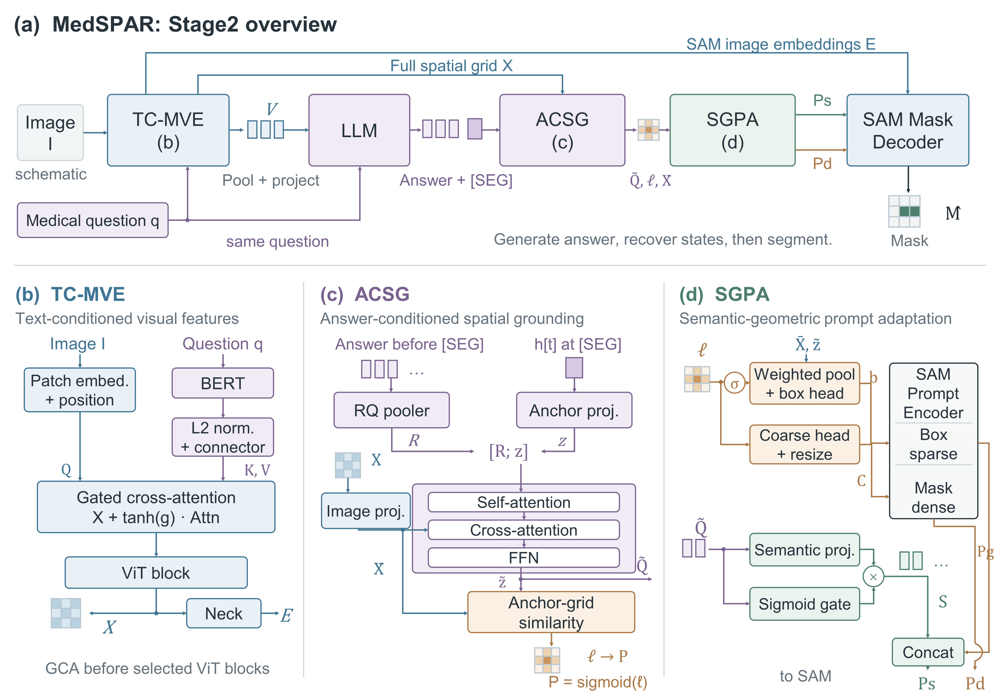

<h1 align="center">
MedSPAR: Spatial Prompt Adaptation<br>
for Medical Reasoning Segmentation
</h1>

<p align="center">
  <a href="https://wanghan-hub.github.io/MedSPAR/"></a>
  &ensp;
  
  &ensp;
  <a href="https://huggingface.co/datasets/HanWangAI/MedSPAR-Data"></a>
  &ensp;
  <a href="https://huggingface.co/HanWangAI/MedSPAR"></a>
  &ensp;
  <a href="https://www.modelscope.cn/datasets/HanWangAI/MedSPAR-Data"></a>
  &ensp;
  <a href="https://www.modelscope.cn/models/HanWangAI/MedSPAR"></a>
</p>

## Introduction

**MedSPAR** is a framework for medical image reasoning segmentation. Given a 2D medical image and a natural-language question, it generates a textual answer and segments the corresponding target. MedSPAR connects question-conditioned medical visual features with answer-conditioned spatial grounding, translating language representations into geometric and semantic prompts for pixel-level segmentation.

The framework consists of three components:

- **Text-Conditioned Medical Visual Encoder (TC-MVE)** incorporates question information into MedSAM visual features.
- **Answer-Conditioned Spatial Grounding (ACSG)** associates answer representations and a `[SEG]` anchor with the spatial visual grid.
- **Semantic–Geometric Prompt Adaptation (SGPA)** produces bounding-box, coarse-mask and semantic prompts for the SAM mask decoder.

## Overview

<p align="center">
  
</p>

MedSPAR preserves spatial visual features along two complementary paths: the full patch grid supports answer-conditioned grounding, while image embeddings directly support mask decoding. A compressed visual prefix connects the encoder to the language model. During inference, the generated answer supplies the representations used to construct spatial and semantic prompts.

## Installation

Clone the repository and create the `medspar` Conda environment:

```bash
git clone https://github.com/wanghan-hub/MedSPAR.git
cd MedSPAR
conda create -n medspar python=3.10 -y
conda activate medspar
```

Install PyTorch 2.7.1 with CUDA 11.8 and its matching torchvision and torchaudio packages, then install the remaining dependencies:

```bash
pip install torch==2.7.1+cu118 torchvision==0.22.1+cu118 torchaudio==2.7.1+cu118 --index-url https://download.pytorch.org/whl/cu118
pip install -r requirements.txt
```

The language-model configuration uses Qwen3.5; use a Transformers version that supports the selected backbone.

## Dataset

Download **MedSPAR-Data** from [Hugging Face](https://huggingface.co/datasets/HanWangAI/MedSPAR-Data) or [ModelScope](https://www.modelscope.cn/datasets/HanWangAI/MedSPAR-Data). It pairs 2D medical images with segmentation questions, reference answers and binary target masks, covering brain, breast, kidney, liver, lung, pancreas, colorectal polyp, prostate, skin and thyroid tasks.

Organize the data by task group and split:

```text
data/
└── <task_group>/
    ├── train/
    │   ├── train.json
    │   ├── images/
    │   └── masks/
    ├── val/
    │   ├── val.json
    │   ├── images/
    │   └── masks/
    └── test/
        ├── test.json
        ├── images/
        └── masks/
```

Each split JSON contains a list of records with the following fields. Image and mask paths are relative to the split directory.

```json
[
  {
    "image": "images/example.png",
    "mask": "masks/example.png",
    "input": "<segmentation question>",
    "output": "<reference answer> [SEG]"
  }
]
```

The question provides the language input. The reference answer and binary mask provide training supervision; each answer ends with a single `[SEG]` token. Source datasets retain their respective usage and redistribution terms.

## Model Weights

Download the MedSPAR checkpoints from [Hugging Face](https://huggingface.co/HanWangAI/MedSPAR) or [ModelScope](https://www.modelscope.cn/models/HanWangAI/MedSPAR). Prepare the base MedSAM, BERT and language-model resources in the following layout:

```text
pretrained/
├── medsam_vit_b.pth
├── bert-base-uncased/
└── Qwen3.5-2B-SEG/
```

`Qwen3.5-2B-SEG` contains the language model and tokenizer with `[SEG]` registered as a permanent special token. See [Training](#training) for base-model downloads and token preparation.

Set the data, pretrained-resource and downloaded checkpoint paths:

```bash
export DATA_ROOT="$PWD/data"
export PRETRAINED_ROOT="$PWD/pretrained"
export MEDSPAR_CHECKPOINT="/path/to/downloaded/checkpoint.pth"
export GPU_IDS=0
```

## Inference

Run answer generation and segmentation on a small subset of the test data:

```bash
python tools/run_experiments.py eval \
  --stage stage2 --experiment main \
  --checkpoint "$MEDSPAR_CHECKPOINT" \
  --eval_gpu_id 0 --max_samples 2 \
  --output_dir output/medspar_preview
```

This processes two samples per task group, generating text and segmentation predictions together with visualizations and scores. Model predictions use the image and question; ground-truth masks are used for scoring.

## Training

### 1. Prepare pretrained models

Download the following resources and place them under `pretrained/`:

- **[Qwen3.5-2B](https://huggingface.co/Qwen/Qwen3.5-2B)** → `pretrained/Qwen3.5-2B/`.
- **[MedSAM ViT-B checkpoint](https://huggingface.co/wanglab/medsam-vit-base/resolve/main/medsam_vit_b.pth)** → `pretrained/medsam_vit_b.pth`.
- **[BERT-base-uncased](https://huggingface.co/google-bert/bert-base-uncased)** → `pretrained/bert-base-uncased/`.

Download the complete Qwen and BERT model directories, including their tokenizer and configuration files.

### 2. Add the segmentation token

Run `add_seg_token_to_llm.py` on the downloaded Qwen model to register `[SEG]` and save the updated tokenizer and model:

```bash
python tools/add_seg_token_to_llm.py \
  --model_path pretrained/Qwen3.5-2B \
  --output_dir pretrained/Qwen3.5-2B-SEG \
  --seg_token "[SEG]" \
  --local_files_only --dtype bf16
```

The training code uses `[SEG]` as its segmentation token. Use the generated `Qwen3.5-2B-SEG/` directory for training and inference.

### 3. Train MedSPAR

With `DATA_ROOT`, `PRETRAINED_ROOT` and `GPU_IDS` configured as above, train the text-conditioned visual model, followed by MedSPAR:

```bash
# Stage 1: Steer-MedSAM visual preparation
python tools/run_experiments.py train --stage stage1

# Stage 2: MedSPAR
python tools/run_experiments.py train --stage stage2 --experiment main
```

Stage 1 saves its best checkpoint to `work_dir/stage1_TC-MVE/best.pth`, which initializes Stage 2. The MedSPAR checkpoint is saved to `work_dir/stage2_MedSPAR/best.pth`. Training settings are provided in `configs/stage1_tc_mve.json` and `configs/stage2_medspar.json`.

For multi-GPU training, set `GPU_IDS` to the available devices, for example `export GPU_IDS=0,1,2,3`.

## Evaluation

Evaluate MedSPAR on the complete test split:

```bash
python tools/run_experiments.py eval \
  --stage stage2 --experiment main \
  --checkpoint "$MEDSPAR_CHECKPOINT" \
  --eval_gpu_id 0 --split test \
  --output_dir output/medspar_test
```

Evaluation reports **Dice, IoU and Recall** at the original mask resolution, with overall, per-task and per-sample results. Generated answers without exactly one valid `[SEG]` are counted as segmentation failures and remain in the overall evaluation. Use a new output directory for each run.

## Acknowledgements

MedSPAR builds on [SAM](https://github.com/facebookresearch/segment-anything), [MedSAM](https://github.com/bowang-lab/MedSAM), BERT and LoRA-based language-model adaptation. We thank the authors and the medical dataset contributors for their work. The upstream SAM license is included in `licenses/segment_anything_LICENSE`.
